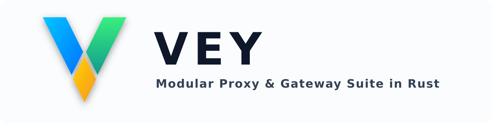

[中文版 README](README.zh_CN.md) | [English README](README.md)

## 概要

VEY は、Rust で構築されたモジュラーなネットワークデーモン・CLI ツールスイートです。セキュリティ監査機能を備えた統合プロキシ（`vey-proxy`）、TLS・Keyless SSL ゲートウェイ／秘密鍵サービス（`vey-gateway`、`vey-keyless`）、StatsD メトリクス受信・集約・転送サービス（`vey-statsd`）、マルチプロトコルベンチマークツール（`vey-bench`）を汎用アプリケーションとし、補助サービス（`vey-dcgen`、`vey-iploc`）および証明書生成ユーティリティ（`vey-mkcert`）を備えており、ロードバランサー (TBD) や NAT トラバーサル (WIP) の拡張も予定しています。

このプロジェクトは、[G3 プロジェクト](https://github.com/bytedance/g3) の作者によるフォークです。

既存のG3環境を移行する場合は、以下のドキュメントを参照してください。
[G3からVEYへの移行](doc/migrate_from_g3_to_vey.md)

## アプリケーション

VEY プロジェクトは複数のアプリケーションで構成されており、それぞれにコード、ドキュメント、関連ファイルを含む
専用のサブディレクトリがあります。

各アプリケーションのディレクトリに加えて、リポジトリには共通で利用するディレクトリもあります。

- [doc](doc): プロジェクト全体のドキュメント。
- [sphinx](sphinx): 各アプリケーションの HTML リファレンスドキュメントを生成するためのソース一式。
- [scripts](scripts): カバレッジテスト、パッケージングスクリプトなどの各種補助スクリプト。

### vey-proxy

非同期 Rust で構築されたモジュラーな汎用プロキシデーモンです。HTTP(S)・SOCKS4/5 フォワードプロキシ、
HTTP/TLS リバースプロキシ、SNI・TPROXY トランスペアレントプロキシ、TCP/UDP/TLS ストリームプロキシを
グレースフルリロード対応の単一バイナリに統合し、組み込みのセキュリティ監査（TLS/TLCP インターセプト、DPI、
ICAP アダプテーション、ストリームデツアー、復号トラフィック出力）、プログラマブルな出口ルーティング、
ユーザー・サイト単位のポリシー制御、StatsD による可観測性を備えています。

#### 主な機能

- 非同期 Rust による実装とグレースフルリロード・マルチワーカー構成への対応
- HTTP(S) および SOCKS4/5 フォワードプロキシ（HTTP CONNECT-UDP、SOCKS5 UDP ASSOCIATE を含む）
- SNI プロキシおよび Linux TPROXY / FreeBSD `ipfw` / OpenBSD `pf` による TCP/UDP トランスペアレントプロキシ
- サイトグループに基づく HTTP / TLS リバースプロキシ：HTTP/1、TLS 上の HTTP/2、WebSocket、パッシブヘルスチェック、サイト単位のオリジンとテナント制限
- PROXY Protocol 対応の TCP/UDP/TLS ストリームプロキシ
- 組み込みのセキュリティ監査：タスク単位サンプリング、TLS/TLCP インターセプト（`vey-dcgen` による動的証明書発行）、復号トラフィック出力、ストリームデツアー、HTTP/1・HTTP/2・WebSocket・IMAP・SMTP の DPI
- コンテンツ検査や DLP 向けの ICAP（`REQMOD` / `RESPMOD`）連携
- プロキシチェーンおよびクライアント IP・宛先ホスト・名前解決 IP・GeoIP・外部ルート選択エージェントによる動的出口ルーティング
- OpenSSL / BoringSSL / AWS-LC / AWS-LC-FIPS / Tongsuo（TLCP 対応）/ rustls に対応したマルチスタック TLS
- 柔軟な認証（ローカル、LDAP、Lua、Python）、ACL、クォータ、レート・帯域制限、ユーザー単位のサイトポリシー
- 構造化監査・タスクログ（journald、syslog、fluentd）および入口・出口・ユーザー・ユーザーサイト・リバースプロキシサイト単位の StatsD
  メトリクス

[README](vey-proxy/README.md) | [ユーザーガイド](vey-proxy/UserGuide.en_US.md) |
[リファレンスドキュメント](https://vey.readthedocs.io/projects/proxy/en/latest/)

### vey-gateway

開発進行中の汎用リバースプロキシ / ゲートウェイデーモンです。複数のフロントエンド / 上流プロトコルに対応する
プログラマブルなゲートウェイ基盤として設計されており、現時点では TLS および keyless 関連のトラフィック処理を
サポートしています。

[README](vey-gateway/README.md) |
[リファレンスドキュメント](https://vey.readthedocs.io/projects/gateway/en/latest/)

### vey-keyless

Cloudflare Keyless SSL プロトコルのサーバー実装です。TLS エッジサービスから秘密鍵演算を専用バックエンドへ
委譲できるため、秘密鍵の集中管理や OpenSSL ベースのハードウェアアクセラレーションとの統合に適しています。

[README](vey-keyless/README.md) |
[リファレンスドキュメント](https://vey.readthedocs.io/projects/keyless/en/latest/)

### vey-statsd

StatsD 互換のメトリクス受信・集約・転送サービスです。アプリケーションから送られたメトリクスを取り込み、
パイプライン上で正規化や集約を行い、Graphite、OpenTSDB、Prometheus、InfluxDB、VictoriaMetrics、QuestDB、OpenGemini
などの下流システムへ出力できます。

[README](vey-statsd/README.md) |
[リファレンスドキュメント](https://vey.readthedocs.io/projects/statsd/en/latest/)

### vey-bench

以下をサポートするマルチプロトコルベンチマークツールです。

- HTTP: HTTP/1.1, HTTP/2, HTTP/3
- WebSocket
- TLS Handshake
- DNS: UDP, TCP, DNS over TLS, DNS over HTTP, DNS over QUIC, DNS over HTTP/3
- Thrift RPC
- Cloudflare Keyless

[README](vey-bench/README.md)

## 補助サービス・ユーティリティ

### vey-dcgen

`vey-proxy` の TLS インターセプト向け動的証明書生成補助サービスです。

[README](vey-dcgen/README.md) |
[リファレンスドキュメント](https://vey.readthedocs.io/projects/dcgen/en/latest/)

### vey-iploc

`vey-proxy` の GeoIP サポート向け IP ジオロケーション検索補助サービスです。

[README](vey-iploc/README.md) |
[リファレンスドキュメント](https://vey.readthedocs.io/projects/iploc/en/latest/)

### vey-mkcert

Root CA / Intermediate CA / TLS サーバー・クライアント / TLCP サーバー・クライアント証明書を生成するための
補助 CLI ツールです。

[README](vey-mkcert/README.md)

## 対応プラットフォーム

[Target Platforms](doc/target_platforms.md) を参照してください。

## 開発環境セットアップ

[Dev-Setup](doc/dev-setup.md) を参照してください。

## 標準

[Standards](doc/standards.md) を参照してください。

## ビルド、パッケージング、デプロイ

ビルド済みパッケージは [cloudsmith](https://cloudsmith.io/~vey-oss/repos/) から入手できます。

linux/amd64 と linux/arm64 のコンテナイメージは GHCR で公開しています。`<version>`
はそのアプリケーションのリリースバージョンです（例: `1.15.1`）。デフォルトタグは Debian です。`:<version>-debian` と
`:<version>-alpine` でベースイメージを選べます。

| アプリケーション                          | イメージ                               | GitHub Packages                                                        |
|-------------------------------------------|----------------------------------------|------------------------------------------------------------------------|
| [vey-proxy](vey-proxy/docker/README.md)   | `ghcr.io/vey-oss/vey-proxy:<version>`  | [vey-proxy](https://github.com/VEY-OSS/vey/pkgs/container/vey-proxy)   |
| [vey-statsd](vey-statsd/docker/README.md) | `ghcr.io/vey-oss/vey-statsd:<version>` | [vey-statsd](https://github.com/VEY-OSS/vey/pkgs/container/vey-statsd) |
| [vey-dcgen](vey-dcgen/docker/README.md)   | `ghcr.io/vey-oss/vey-dcgen:<version>`  | [vey-dcgen](https://github.com/VEY-OSS/vey/pkgs/container/vey-dcgen)   |
| [vey-iploc](vey-iploc/docker/README.md)   | `ghcr.io/vey-oss/vey-iploc:<version>`  | [vey-iploc](https://github.com/VEY-OSS/vey/pkgs/container/vey-iploc)   |

ただし、可能であればパッケージは自前でビルドすることを推奨します。詳細は
[Build and Package](doc/build_and_package.md) を参照してください。

### LTS バージョン

[Long-Term Support](doc/long-term_support.md) を参照してください。

## コミュニティ

Larksuite (飛書)
のユーザーグループに参加するには、こちらの[リンク](https://applink.feishu.cn/client/chat/chatter/add_by_link?link_token=a7an15cf-4851-41ee-9741-b3a223ab9998)
をクリックするか、以下のQRコードをスキャンしてください：

## コントリビューション

詳細は [Contributing](CONTRIBUTING.md) を参照してください。

## 行動規範

詳細は [Code of Conduct](CODE_OF_CONDUCT.md) を参照してください。

## セキュリティ

セキュリティ上の問題は、GitHub の
[draft security advisory](https://github.com/VEY-OSS/vey/security/advisories/new) を作成して報告してください。

公開の GitHub Issue は作成しないでください。

## ライセンス

このプロジェクトは [Apache-2.0 License](LICENSE) のもとで提供されています。
