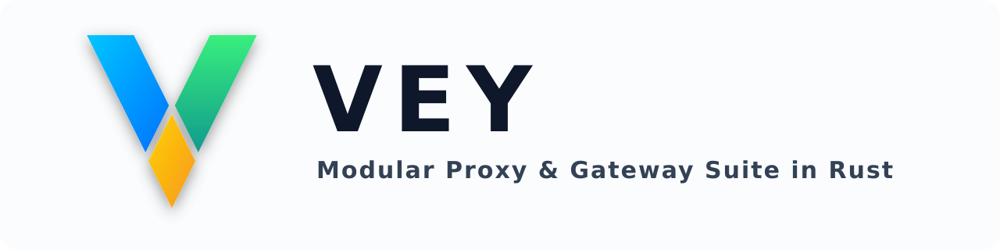

[English README](README.md) | [日本語 README](README.ja_JP.md)

## 关于

VEY 是一套基于 Rust 构建的模块化网络守护进程与命令行工具套件。通用应用涵盖支持内建安全审计的通用代理（`vey-proxy`）、TLS 与
Keyless SSL 网关及私钥服务（`vey-gateway`、`vey-keyless`）、StatsD 指标接入聚合与转发服务（`vey-statsd`）以及多协议基准压测工具（`vey-bench`），并配套提供辅助服务（`vey-dcgen`、`vey-iploc`）与证书生成辅助工具（`vey-mkcert`），同时规划支持负载均衡（待定）与
NAT 穿透（开发中）等能力。

本项目由 [G3 项目](https://github.com/bytedance/g3) 原作者 fork 并发起。

如果您要迁移现有的 G3 部署，请参阅[从 G3 迁移到 VEY](doc/migrate_from_g3_to_vey.md)。

## 应用程序

VEY 项目由多个应用组成，每个应用都有独立的子目录，用于存放各自的代码、文档及相关资源。

除各应用目录外，仓库中还包含一些公共目录：

- [doc](doc) 包含项目级文档。
- [sphinx](sphinx) 用于生成各应用的 HTML 参考文档。
- [scripts](scripts) 包含各类辅助脚本，例如覆盖率测试和打包脚本。

### vey-proxy

基于 Async Rust 构建的模块化通用代理守护进程。它将 HTTP(S)/SOCKS4/5 正向代理、HTTP/TLS 反向代理、SNI 与
TPROXY 透明代理以及 TCP/UDP/TLS 流代理统一在一个支持热重载的二进制中，并内建安全审计（TLS/TLCP 拦截、DPI 协议识别、ICAP
适配、流分流与解密流量导出）、可编程出口路由、按用户与按站点精细化策略以及可观测性能力。

#### 主要特性

- 基于 Async Rust 实现，支持优雅热重载与多 Worker 扩展
- 支持 HTTP(S) 与 SOCKS4/5 正向代理，包含 HTTP CONNECT-UDP 与 SOCKS5 UDP ASSOCIATE
- 支持 SNI 透明代理，以及基于 Linux TPROXY、FreeBSD `ipfw` 和 OpenBSD `pf` 的 TCP/UDP 透明代理
- 支持基于站点组的 HTTP / TLS 反向代理：HTTP/1、TLS 上的 HTTP/2、WebSocket、被动健康检查以及按站点配置的源站与租户限额
- 支持 TCP/UDP/TLS 流代理与 PROXY Protocol
- 内建安全审计引擎：支持任务采样、TLS/TLCP 拦截（配合 `vey-dcgen` 动态签发证书）、解密流量导出、流分流，以及 HTTP/1、HTTP/2、WebSocket、IMAP、SMTP 的 DPI 协议识别
- 支持 ICAP（`REQMOD` / `RESPMOD`）集成，可用于内容审计、DLP 与应用层流量适配
- 支持代理串联，以及按客户端 IP、目标主机、解析 IP、GeoIP 或外部选路 Agent 的动态出口路由
- TLS 支持 OpenSSL、BoringSSL、AWS-LC、AWS-LC-FIPS、Tongsuo（含国密 TLCP）与 rustls
- 支持灵活认证（本地、LDAP、Lua、Python）、ACL、配额、限速限流及按用户细化的站点策略
- 支持结构化任务/检测/拦截审计日志（journald、syslog、fluentd）与覆盖入口、出口、用户、用户站点及反向代理站点维度的 StatsD 指标

[详细介绍](vey-proxy/README.md) | [用户指南](vey-proxy/UserGuide.zh_CN.md) |
[参考文档](https://vey.readthedocs.io/projects/proxy/en/latest/)

### vey-gateway

一个仍在开发中的通用反向代理 / 网关守护进程。它被设计成可支持多种前端协议与上游协议的可编程网关框架，目前已经支持
TLS 与 keyless 相关的流量处理能力。

[详细介绍](vey-gateway/README.md) |
[参考文档](https://vey.readthedocs.io/projects/gateway/en/latest/)

### vey-keyless

Cloudflare Keyless SSL 协议的服务端实现。它可以让 TLS 边缘服务把私钥运算委托给独立后端，从而更容易实现密钥集中管理，
并集成基于 OpenSSL 的硬件加速能力。

[详细介绍](vey-keyless/README.md) |
[参考文档](https://vey.readthedocs.io/projects/keyless/en/latest/)

### vey-statsd

兼容 StatsD 的指标接入、聚合与转发服务。它可以接收应用发来的指标数据，在模块化流水线中完成规范化或聚合，再输出到
Graphite、OpenTSDB、Prometheus、InfluxDB、VictoriaMetrics、QuestDB、OpenGemini 等下游系统。

[详细介绍](vey-statsd/README.md) |
[参考文档](https://vey.readthedocs.io/projects/statsd/en/latest/)

### vey-bench

多协议基准压测工具，支持：

- HTTP: HTTP/1.1, HTTP/2, HTTP/3
- WebSocket
- TLS Handshake
- DNS: UDP, TCP, DNS over TLS, DNS over HTTP, DNS over QUIC, DNS over HTTP/3
- Thrift RPC
- Cloudflare Keyless

[详细介绍](vey-bench/README.md)

## 辅助服务与工具

### vey-dcgen

适用于 `vey-proxy` TLS 劫持功能的动态证书生成辅助服务。

[详细介绍](vey-dcgen/README.md) |
[参考文档](https://vey.readthedocs.io/projects/dcgen/en/latest/)

### vey-iploc

适用于 `vey-proxy` GeoIP 功能的 IP 地理位置查询辅助服务。

[详细介绍](vey-iploc/README.md) |
[参考文档](https://vey.readthedocs.io/projects/iploc/en/latest/)

### vey-mkcert

用于生成根 CA、中间 CA、TLS 服务端/客户端及国密 TLCP 服务端/客户端证书的辅助命令行工具。

[详细介绍](vey-mkcert/README.md)

## 支持平台

参考 [Target Platforms](doc/target_platforms.md)。

## 开发环境搭建

参考 [Dev-Setup](doc/dev-setup.md)。

## 标准及约定

参考 [Standards](doc/standards.md)。

## 构建、打包及部署

预编译包可在 [cloudsmith](https://cloudsmith.io/~vey-oss/repos/) 获取。

linux/amd64 与 linux/arm64 的容器镜像发布在 GHCR。`<version>` 是该应用的发布版本，例如 `1.15.1`。默认标签是 Debian。
`:<version>-debian` 与 `:<version>-alpine` 用来选择基础镜像。

| 应用                                      | 镜像                                   | GitHub Packages                                                        |
|-------------------------------------------|----------------------------------------|------------------------------------------------------------------------|
| [vey-proxy](vey-proxy/docker/README.md)   | `ghcr.io/vey-oss/vey-proxy:<version>`  | [vey-proxy](https://github.com/VEY-OSS/vey/pkgs/container/vey-proxy)   |
| [vey-statsd](vey-statsd/docker/README.md) | `ghcr.io/vey-oss/vey-statsd:<version>` | [vey-statsd](https://github.com/VEY-OSS/vey/pkgs/container/vey-statsd) |
| [vey-dcgen](vey-dcgen/docker/README.md)   | `ghcr.io/vey-oss/vey-dcgen:<version>`  | [vey-dcgen](https://github.com/VEY-OSS/vey/pkgs/container/vey-dcgen)   |
| [vey-iploc](vey-iploc/docker/README.md)   | `ghcr.io/vey-oss/vey-iploc:<version>`  | [vey-iploc](https://github.com/VEY-OSS/vey/pkgs/container/vey-iploc)   |

但仍推荐自行编译并打包，具体方法请参考 [Build and Package](doc/build_and_package.md)。

### 长期支持版本

参考 [Long-Term Support](doc/long-term_support.md)。

## 社区交流

欢迎通过[此链接](https://applink.feishu.cn/client/chat/chatter/add_by_link?link_token=a7an15cf-4851-41ee-9741-b3a223ab9998)
或扫描下方二维码加入飞书 (Larksuite) 用户交流群：

## 贡献指南

参考 [Contributing](CONTRIBUTING.md)。

## 贡献者公约

参考 [Code of Conduct](CODE_OF_CONDUCT.md)。

## 安全

如发现安全问题，请在 GitHub 上
[创建 security advisory 草稿](https://github.com/VEY-OSS/vey/security/advisories/new)，不要直接提交公开 issue。

## 许可证

本项目基于 [Apache-2.0 License](LICENSE) 发布。
